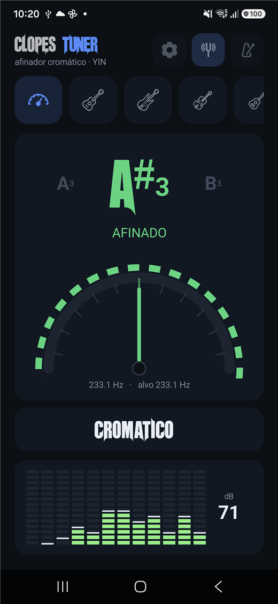
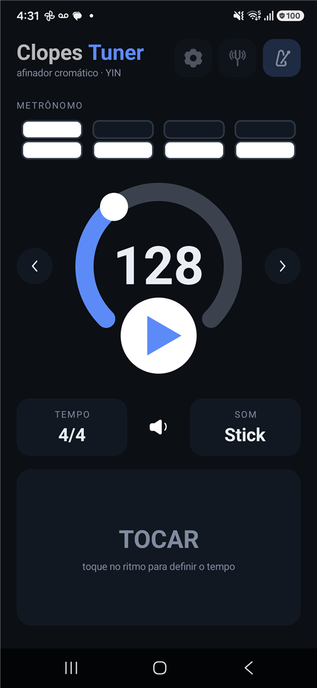
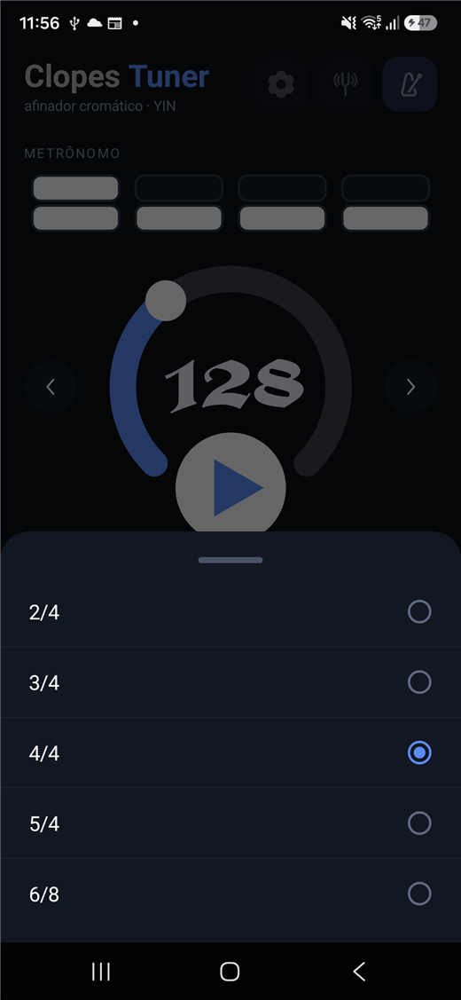
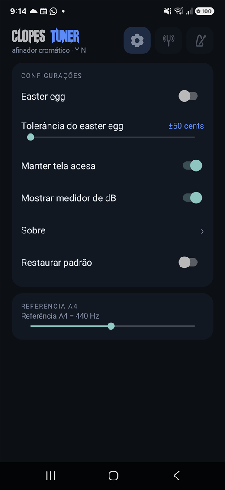

# Clopes Tuner

Afinador cromático e metrônomo para Android, escrito em Kotlin, com interface
própria — sem AndroidX, sem bibliotecas de UI.



## Recursos

### Afinador

- Detecção de pitch por **YIN** em blocos de 4096 amostras a 44,1 kHz, com
  mediana das últimas 7 leituras.
- Nota + oitava, erro em **cents**, frequência lida, frequência alvo e a corda
  mais próxima da nota.
- **Faixa de instrumentos** com rolagem lateral: cromático, violão, baixo,
  violino, ukulele, banjo e bandolim.
- Semitons vizinhos nas laterais (`G#4 · A4 · A#4`) para indicar para que lado a
  corda está puxando.
- Medidor de nível por banda (12 colunas de 60 Hz a 8 kHz) com pico e leitura
  em dB.
- Referência **A4 de 415 a 466 Hz** nas configurações.
- Retenção da última nota por 2,5 s, com a leitura esmaecendo quando o som para.

### Metrônomo

- 30 a 300 BPM: anel arrastável, setas de ±1 e botão de play.
- Compasso 2/4, 3/4, 4/4, 5/4 e 6/8 escolhido em **bottom sheet** que sobe da
  base, arrasta e fecha.
- Cada tempo é uma caixa de duas linhas: normal, acentuado ou mudo (toque para
  alternar).
- Amostras de stick e snare, com acento no primeiro tempo.
- Pad **TOCAR** funciona como tap tempo: o BPM vem da média dos intervalos.

### Configurações

Manter tela acesa, mostrar medidor de dB, tolerância do conteúdo extra,
restaurar padrão, referência A4 e "Sobre".

## Telas

| Metrônomo | Compasso | Configurações |
|---|---|---|
|  |  |  |

## Como compilar

Requisitos: **JDK 21**, **Android SDK 35** e **Gradle 8.9**.

```powershell
# com JDK e SDK já configurados no ambiente
gradle assembleDebug

# ou pelo script, que também roda os testes antes
.\build.ps1
```

O script usa `JAVA_HOME`/`ANDROID_HOME` quando existem e, de outro modo, procura
um toolchain local (pasta `..\ClopesCast\CastDoClopes\toolchain`). Também aceita
`-Toolchain <pasta>` ou a variável `CLOPES_TOOLCHAIN`.

Saída: `app\build\outputs\apk\debug\app-debug.apk` (o script copia para
`ClopesTuner.apk`).

## Estrutura

| Arquivo | Responsabilidade |
|---|---|
| `MainActivity.kt` | telas, navegação por abas, configurações e ciclo de vida |
| `PitchDetector.kt` | YIN sobre blocos de áudio |
| `TunerEngine.kt` | `AudioRecord` em 44,1 kHz e distribuição das leituras |
| `Spectrum.kt` | FFT de 1024 pontos e bandas de frequência |
| `Notes.kt` | notas, oitavas, presets de afinação e corda mais próxima |
| `Metronome.kt` | relógio do metrônomo e `SoundPool` com as amostras |
| `TempoSheet.kt` | bottom sheet de compasso (arrasto e animação) |
| `NeedleView.kt` | arco de cents com estroboscópio |
| `LevelMeterView.kt` | medidor de nível segmentado |
| `PlayButtonView.kt` | botão de play desenhado em código |
| `BeatBoxView.kt` | caixa de tempo com duas linhas |
| `TempoRingView.kt` | anel de BPM arrastável |

## Testes

```powershell
gradle testDebugUnitTest
```

15 testes: 7 do detector de pitch (senoides com ruído, harmônicos, silêncio,
fora da faixa) e 8 da sequência do conteúdo extra.

## Compatibilidade

- `minSdk 26`, `targetSdk 35`
- Testado em Android 16 (1080 × 2340)

## Observações

- As fontes **Unrealised** e **Avebury** usadas no logo e no BPM têm licença
  própria; os arquivos estão no projeto para o app compilar como está.
- O vídeo do conteúdo extra responde por quase todo o tamanho do APK.

## Temas

O app tem 6 temas, escolhidos em **Configurações → Tema** (ficam salvos):

| Tema | Visual |
|---|---|
| **Escuro** | fundo sólido, cartões escuros (padrão) |
| **Vidro** | gradiente azul→roxo, cartões translúcidos com borda em gradiente |
| **Neon** | gradiente roxo/ciano, acento roxo e verde neon |
| **Âmbar** | paleta quente, marrom e âmbar |
| **Floresta** | verde profundo |
| **Claro** | fundo claro com cartões brancos |

O vídeo e a interface se adaptam ao tema, incluindo as barras do sistema.

## Licença

GNU General Public License v3.0 — veja [LICENSE](LICENSE).
